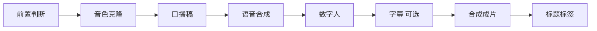

# AutoVid 短视频口播工作台

AutoVid 是一个基于 LangGraph 的短视频口播生成工作流。准备文案、个人音色和真人出镜视频，选择已配置的语音与视频服务，即可生成口播成片。字幕可选，默认跟随视频底片的分辨率与帧率导出，不强制竖屏。

项目当前只负责生成视频、封面和标题标签，不包含社交平台自动发布。

## 主要能力

- **八节点工作流**：前置检查、音色克隆、口播稿、语音合成、数字人、字幕、成片、标题标签。
- **可插拔 Provider**：语音和数字人通过统一接口接入，供应商、模型与密钥在设置页管理。
- **严格失败模式**：所选 API 失败时直接停止并说明认证、余额、权限或响应问题，不会偷偷换成默认声音、静态画面或本地模型。
- **可复用素材**：音色库保存参考录音、准确文稿及可选音频直链；视频底片上传后可以反复使用，照片素材作为兼容功能保留。
- **中文音色名称**：新建音色只接受中文汉字；厂商注册名称由系统独立生成，不把中文显示名直接提交给限制英文名称的接口。
- **可选字幕**：按气口句逐句合成语音，再根据 PCM 样本数生成 ASS 字幕时间轴；关闭字幕后直接输出无新增字幕的成片。
- **断点恢复**：有持久化检查点时，可从异常节点继续并复用已完成节点；节点内已提交的云端任务还需由适配器处理查询与结果复用。
- **中间产物可用**：任务失败后仍可下载已经生成的音频、数字人片段和字幕等文件。
- **本地 Web 工作台**：创作按文案、视频底片、声音与服务分组，历史、素材和设置独立。支持明暗主题并记住选择。
- **照片模式可恢复**：默认隐藏照片输入和照片服务，可在设置中恢复，不删除原素材、适配器或历史。
- **视频底片口型替换**：阿里云 VideoRetalk 使用真人底片和配音替换口型，保留底片中的衣服、背景和动作，不生成新手势。详见 [录制与配置指南](docs/videoretalk.md)。不同账号的权限、费用与效果需要实际验证。

## 工作流



| 节点 | 作用 | 主要产物 |
| --- | --- | --- |
| 前置判断 | 检查文案、音色、对应服务、输出目录及当前模式所需素材 | 检查结果与明确错误 |
| 音色克隆 | 注册或复用所选音色的云端音色 ID | 音色注册信息 |
| 口播稿 | 使用自有文案，或根据选题生成结构化口播稿 | 分段文案 |
| 语音合成 | 按气口句合成并拼接配音 | WAV 与逐句时间轴 |
| 数字人 | 默认用人物视频底片和配音替换口型；照片协议在兼容模式使用 | 一个或多个视频片段 |
| 字幕 | 开启时根据语音时间轴生成 ASS 字幕，关闭时跳过 | 可选的 `subtitles.ass` |
| 合成成片 | 按导出规格拼接片段、合入音频，仅在开启字幕时烧录字幕 | `final.mp4`、封面图 |
| 标题标签 | 根据文案整理标题、简介和标签建议 | 元数据 JSON |

文案确认和试听音色是可选的人审闸门，默认关闭；在 Web 工作台勾选后才会暂停等待确认。

## 快速开始

### 1. 获取代码

```powershell
git clone https://github.com/2528078765/AutoVid.git
cd AutoVid
```

### 2. 准备环境

建议使用 Windows 10/11、Python 3.11 或更高版本，并确保 `ffmpeg`、`ffprobe` 可以在终端直接运行。

LangGraph 依赖安装在项目自己的 `.pylibs/` 中，不污染系统 Python：

```powershell
python scripts\vendor_deps.py langgraph
python scripts\vendor_deps.py langgraph-checkpoint-sqlite
python scripts\check_env.py
```

### 3. 启动工作台

```powershell
python -m autovid web --open
```

默认地址为 `http://127.0.0.1:8899/`。如果端口被占用，程序会自动选择其他可用端口并在终端显示。

### 4. 完成首次配置

1. 打开“服务设置”，分别添加语音服务和视频生成服务。
2. 选择已适配的具体模型卡片，填写 API Key 和卡片要求的附加字段，例如北京业务空间 ID。
3. 点击“测试连通”。它只按该服务的探测接口检查连接、鉴权或权限，不提交生成任务，也不保证实际生成可用。
4. 在“音色库”用中文汉字新建音色，按下方语音配置表准备本地录音或 HTTPS 音频直链。要求参考文字的服务必须填写实际朗读内容。
5. 在“视频底片”上传本人的出镜视频；照片相关功能默认隐藏，可在服务设置的兼容功能中恢复。
6. 回到“创作”，填写文案或主题，选择视频底片、音色及对应服务，先试听声音，再开始生成。

未配置的 Provider 不会出现在创作页的引擎选择中。视频模式需要音色和人物视频底片，不需要额外选择形象照片。保存配置或素材不等于云端可用：先试听一句，确认内容、音色正常，再提交整条视频。

创作页的“添加字幕”默认勾选。取消后会跳过字幕生成，成片不添加正文字幕或顶部关键词；独立封面照常生成，原素材中已有的文字不会被移除。命令行运行时，可在 `config/pipeline.json` 中将 `steps.subtitles.enabled` 设置为 `false`。

## Provider 机制

服务设置按具体模型展示卡片。阿里云语音每张卡片绑定一个模型及完整的注册、合成协议，不再通过同一张供应商卡片随意改模型 ID。其他供应商仍保留，不强制统一使用阿里云。

官方固定接口会自动填写并锁定；自建服务和兼容接口可以手动填写地址与模型 ID。新增适配主要集中在：

- `autovid/providers_registry.py`：供应商模板、模型、字段和能力声明。
- `autovid/providers.py`：语音、音色克隆和数字人调用实现。
- `autovid/provider_caps.py`：分辨率、素材限制和失败签名。

Provider 配置保存在 `config/providers.json`，API Key 单独保存在被 Git 忽略的 `config/secrets.json`。

仓库中的 Provider 列表和音色、形象选择保持为空，不包含作者账号配置。首次启动请在服务设置添加自己的服务；示例配置中的 `cloud_tts`、`http_job` 不是可直接生成的免费服务，也不会自动降级生成。

### 语音配置与参考录音

在“服务设置”的语音服务区域添加具体模型，然后在创作页选择该服务和音色。下表描述本项目当前适配，不代表厂商完整模型列表或账号已获授权。

| 服务或模型 | 参考素材 | 注意事项 |
| --- | --- | --- |
| 硅基流动 CosyVoice2 | 本地录音 + 与录音一致的文字 | 直接提交录音，不需要 OSS 或音频直链；当前适配上限 25 秒，文字与音频必须匹配 |
| 阿里云 CosyVoice 3.5/3/2、Qwen-Audio 3.0 | 公网可下载的 HTTPS 音频直链 | 可使用私有 OSS 的临时签名链接；保存链接不会自动上传本地文件 |
| 千问三声音复刻兼容适配 | 本地参考录音 | 保留适配入口，模型是否仍开放及账号权限需实际核实；不能只靠改模型 ID 判断可用 |
| 其他供应商 | 按对应模型卡片要求 | 不强制统一供应商；不同模型的音色 ID 不能直接混用 |

#### 音色名称与云端音色 ID

- 新名称只能使用中文汉字，例如“讲解声音”“我的声音”；英文、数字、内部空格和符号会被界面与服务端拒绝。已有英文名称不会被自动改名或删除。
- **音色库名称**是给用户看的中文名字；**云端注册名称**是系统根据资产 ID 生成的稳定 ASCII 标识；**云端音色 ID**则由厂商在注册成功后返回，用于后续合成。三者不是同一个字段。
- 系统独立保存各服务的注册结果。阿里云模型按模型、账号和业务空间区分缓存；切回相同服务及相同样本可复用已注册音色。
- 更换录音会自动清除旧链接与克隆缓存；参考文字变化也会使相应缓存失效。不需要删除音色重建。
- 一些模型需要等待音色部署完成。已返回的音色 ID 会先保存，查询失败后重试先查询，不直接重复创建。

#### 使用私有 OSS 提供录音链接

1. 在 OSS 创建私有 Bucket，建议与当前北京地域百炼服务放在同一地域，使用标准存储、本地冗余。保持“阻止公共访问”开启，无需公共读或公共读写。
2. 上传本人录音，文件 ACL 选择“私有”或继承私有 Bucket。无需静态网站、自定义域名、CDN 或传输加速。
3. 在文件详情获取 **HTTPS 预签名 URL**，临时测试可设 3600 秒。复制完整地址，包括问号后的所有签名参数，不能使用 `oss://` 路径或控制台页面地址。
4. 在音色库打开对应音色，保存该链接。如同时保存本地录音，必须是链接指向的同一份样本；先上传本地录音，再保存链接，因为重新上传会清除旧链接。
5. 回创作页选对应阿里云模型并试听。签名过期后，如需重新注册音色或重试依赖录音的操作，需重新获取链接并更新；已经成功注册的音色不需要每次重新上传。

预签名链接在有效期内无需登录即可下载，获得完整链接的人也能读取录音，不要公开分享。项目当前仅支持填写链接，没有自动上传 OSS 或自动续签功能，不需要把 OSS AccessKey 填进项目。

OSS 按存储、请求与流量计费，语音与视频生成另行计费。只存少量录音时可先按量付费，无需预购资源包；免费额度以账号实际权益为准。操作见 [OSS 文件链接说明](https://help.aliyun.com/zh/oss/user-guide/how-to-obtain-the-url-of-a-single-object-or-the-urls-of-multiple-objects/)。

连通测试不生成收费音频，不代表已完成音色质量或端到端验收；试听会调用所选云端服务，可能收费。模拟测试仅验证协议和本地处理逻辑，实际声音、权限、余额与费用以真实调用为准。

接口与录音要求见[声音复刻文档](https://help.aliyun.com/zh/model-studio/voice-clone-design-http-api)、[非实时语音合成](https://help.aliyun.com/zh/model-studio/non-realtime-tts-user-guide)。

### 视频底片模式与导出

工作台默认只显示人物视频底片、视频口型替换服务，不再显示照片输入、身份参考及照片服务。原有照片、适配器和历史不会删除；在“服务设置 → 兼容功能显示”打开照片功能可随时恢复（显示偏好保存在当前浏览器）。

VideoRetalk 的模型生成分辨率与帧率由底片决定，并非可任选的模型清晰度档位。创作页默认“跟随视频底片”导出，也可选择竖屏 1080×1920 或 720×1280、30 帧的最终合成规格。导出规格不改变云端生成细节，实际返回规格仍需本次运行核验。人工确认单独作为可选项显示。

## 素材要求

### 音色

- 只上传本人声音或已经获得明确授权的录音。
- 建议录制 10～20 秒安静、自然、无背景音乐的单人讲话；具体格式和时长以上述服务要求及前置检查为准。
- 要求参考文字的模型必须使用实际说出的内容，不要把参考朗读模板当成任意录音的转写。
- 云端音色 ID 与所选服务、模型及账户关联，不能拿阿里云的 ID 直接给硅基流动使用。

### 人物视频底片（默认模式）

- 建议单人、固定机位、光线稳定，上半身和自然手势在画面中完整出现，嘴部避免遮挡。
- 当前 VideoRetalk 适配要求 MP4/MOV/AVI、H.264/H.265 编码，时长大于 2 秒且小于 120 秒，不超过 300MB；宽高均在 640～2048 像素，15～60 帧。
- 底片必须不短于最终配音。项目不会自动倒放循环视频，也不会截断配音来凑时长。
- 衣服、背景、手势来自底片。想换这些内容，需要录制并保存新的底片，而不是更换音色。

### 形象与场景照片（兼容功能，默认隐藏）

- 只使用本人照片或已获得授权的人物素材。
- 出镜照片决定视频里的人物、衣服、姿势和背景，可从形象库或已上传的场景照中选择。
- 需要独立身份参考的引擎会额外显示形象选择；直接驱动出镜照片的引擎不要求重复提供形象。
- 自然讲解模式建议单人、正脸清晰、腰部以上、双手完整入镜，避免遮挡和复杂背景。
- 最终清晰度受数字人 Provider 的原始输出限制；导出为 1080×1920 不会把低分辨率素材变成真实 1080p。

`assets/`、`scenes/`、`runs/` 和 `.tmp/` 均已加入 `.gitignore`，不要把录音、视频底片、照片、签名链接和生成视频提交到仓库。

## 运行、恢复与产物

每次运行保存在 `runs/<运行编号>/`。Web 工作台会显示每个节点的状态与实时日志，并在历史记录中提供：

- 查看已完成结果；
- 下载异常前生成的片段；
- 修正配置后从失败节点继续。

每条历史旁的“删除”会打开确认弹窗。默认只删除记录并保留本地文件；勾选“同时删除本地文件”会清理该次运行目录及对应恢复检查点。正在运行的任务不能删除，音色库、形象库和其他运行不受影响。

默认产物位置为 `runs/<运行编号>/`，历史状态保存在其中的 `flow_state.json`，持久化检查点在 `runs/_graph/flow.sqlite`。视频底片位于 `assets/source_videos/`，音色位于 `assets/voices/<音色ID>/`。修改输出目录配置后，以实际配置路径为准。

安装并启用 SQLite Checkpoint 后可跨进程恢复；如果启动日志提示退回内存检查点，则不能保证重启后恢复。历史快照不等于可用的检查点。失败节点重新执行仍可能产生云端调用，检查点不提供付费 API 的“恰好一次”保证；提交结果不确定时应先查云端任务和账单，不要盲目重复生成。

命令行可以检查状态和恢复人工闸门；异常节点的“继续”使用 Web 历史入口：

```powershell
python -m autovid graph state --thread <thread-id>
python -m autovid graph resume --thread <thread-id> --decision approve
```

使用已配置的视频输入服务时，命令行示例为：

```powershell
python -m autovid graph run `
  --script-file "examples\自然口播样片.txt" `
  --voice-id "voice-替换为实际ID" `
  --source-video "D:\素材\人物底片.mp4"
```

先在配置中选择对应的视频输入 Provider；照片输入服务才使用 `--scene-photo`，需要独立身份参考时再提供 `--avatar-id`，不要混用两种模式的素材。

## 项目结构

```text
autovid/
  graph.py                 LangGraph 八节点编排、闸门和恢复
  providers.py             Provider 调用与统一结果
  providers_registry.py    供应商模板和设置页元数据
  dashscope_voice.py       阿里云语音模型与注册、合成协议
  videoretalk.py           视频底片校验、云端任务查询与片段复用
  provider_caps.py         能力限制与错误分类
  assets.py                音色库和形象库
  media.py                 FFmpeg、ASS 字幕和媒体检查
  web/
    server.py              本地 HTTP、SSE、历史记录和下载接口
    static/index.html      无前端框架的工作台页面
    static/workbench.js    工作台视图与交互辅助
    static/workbench.css   布局、明暗主题与响应式样式
config/
  pipeline.json            输出规格和工作流参数
  providers.json           已添加的 Provider
scripts/                   环境检查、部署、探测与冒烟测试
examples/                  示例口播稿
```

## 开发与验证

常用的无付费验证命令：

```powershell
python -m compileall -q autovid
python scripts\smoke_dashscope_voice.py
python scripts\smoke_workbench.py
python scripts\smoke_videoretalk.py
python scripts\smoke_optional_subtitles.py
python scripts\smoke_flow_web.py
python scripts\smoke_provider_caps.py
```

`scripts/smoke_*.py` 是本项目的回归测试入口。常规测试优先使用本地模拟服务，不要默认调用会产生费用的云端生成接口。修改 Provider 时，至少覆盖成功、认证失败、余额或额度不足、权限不足和异常响应。

`smoke_dashscope_voice.py` 包含中文名称校验、硅基流动云端名称映射、参考音频、音色缓存与阿里云协议回归；`smoke_workbench.py` 在隔离目录验证 Web 输入校验和运行计划；`smoke_run_delete.py` 验证历史删除与文件保留。测试通过不等于真实云端效果验收。

贡献规范见 [AGENTS.md](AGENTS.md)。

## 安全与隐私

- 不要提交 `config/secrets.json`，也不要在日志、Issue 或截图中暴露 API Key、OSS 签名链接或个人素材。
- 语音克隆和数字人生成必须获得声音与肖像权授权。
- 云端 Provider 可能上传参考音频、视频底片、人物照片和文案，请在使用前阅读对应服务条款；“本地工作台”不代表素材只在本机处理。
- 接口失败必须明确报错；不要用默认声音、静音、静态画面或其他模型掩盖失败。

## License

本项目采用 [MIT License](LICENSE)。
